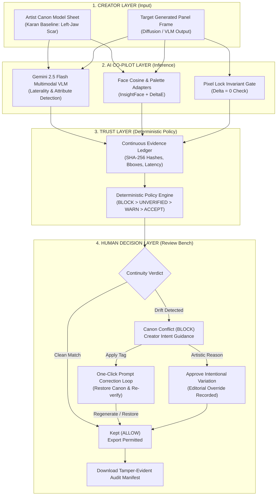

# PanelProof

> **PanelProof is an AI continuity co-pilot for comic and storyboard artists that catches visual drift, explains what changed, and lets the artist decide what stays canonical.**  
> *Track 04: Digital Art & Visual Co-Pilot*  
> *Team: Prompt Pirates — GeNarrative Clash 2026*

---

## What is PanelProof?

**PanelProof** is a creative visual co-pilot designed specifically for comic, manga, webtoon, and storyboard artists. When creators generate story panels using diffusion or generative image models, character traits, scars, hair parts, and palettes inevitably drift across shots. 

PanelProof acts as an **independent visual co-pilot**: it compares generated panels against an artist-defined visual canon, highlights exact regions of drift with spatial bounding reticles, explains **what changed and why it matters**, suggests one-click corrective prompt tags, and keeps the human artist in full control of publication.

---

## Who PanelProof Helps

PanelProof is tailored for sequential narrative visual artists:

* **Comic & Manga Artists:** Generate drafts with Midjourney, Stable Diffusion, or FLUX while guaranteeing recurring facial scars, eye colors, and hairstyles never invert between close-ups and wide angles.
* **Webtoon Creators:** Maintain rapid weekly release schedules without character costume drift or hair parting errors across hundreds of vertical scroll panels.
* **Storyboard Artists & Animators:** Enforce shot-to-shot visual continuity and prop constancy between storyboard keyframes before sending sequences to production.
* **Art Directors & Showrunners:** Establish an auditable, machine-verifiable single source of truth for character model sheets and review studio contractor submissions in minutes.
* **Collaborative Creative Studios:** Share unified character visual canons across distributed teams with zero manual continuity oversight overhead.

---

## The Problem

When visual artists, webtoon creators, and narrative directors use diffusion or generative image models to produce multi-panel sequences, subtle character details drift uncontrollably:
* **Laterality Flips:** Scars, eyepatches, and hair parts invert across camera angles (left jaw vs. right jaw).
* **Costume Mutations:** Collars, buttons, insignias, and armor plates change or disappear from panel to panel.
* **Palette Drift:** Shading, skin tones, and atmospheric house color swatches desaturate unpredictably.
* **Background Shifts:** Static props and environment assets unexpectedly alter during panel character edits.

Today, artists waste hours repeatedly re-prompting or manually fixing hallucinations in Photoshop because generative diffusion models are probabilistic single-image engines with zero awareness of cross-panel story canon.

---

## Why Existing Image Generation is Insufficient

| Approach / Tool | What It Does | Why It Falls Short for Continuity Verification |
|---|---|---|
| **SAM 3 (Segment Anything 3)** | Promptable object concept segmentation and tracking | Detects and tracks masks, but lacks narrative or canon reasoning. Cannot judge if two stylized faces belong to the same character. |
| **InstantID** | Face-identity conditioning from a single image | Single-reference facial spatial adapter. Cannot verify multi-character panels, costumes, props, or non-face traits. |
| **StoryDiffusion** | Consistent self-attention across image batches | A generation framework, not an independent verifier. A generator cannot be the authority that audits its own output. |
| **PanelProof (Our Solution)** | **Independent fail-closed continuity gate** | Treats declared canon as ground truth, generates auditable evidence receipts, enforces pixel invariants, and fails closed when uncertain. |

---

## Four-Layer Creative Co-Pilot Architecture

PanelProof is architected around a human-in-the-loop, evidence-based co-pilot pipeline:



### Core Invariants & Policy Semantics

* **Generator and Verifier are Independent:** The image generator cannot approve its own work.
* **Precedence Ordering:** `BLOCK > UNVERIFIED > WARN > ACCEPT`. The worst check dictates the panel verdict.
* **Model-Inferred Claim Boundary:** Claims declared by the artist can `BLOCK`. Claims automatically inferred by AI models may `WARN`, but are strictly forbidden from blocking export.
* **Fail-Closed on Uncertainty:** Verifier timeouts, API network drops, missing reference sheets, or ambiguous occlusions evaluate to `UNVERIFIED` and prevent export unless explicitly overridden by the artist.
* **Pixel Lock Invariant:** Regions designated as locked must satisfy $\text{locked\_pixel\_delta} = 0$. Invariant breaches are strictly non-overridable.

---

## Interactive Demo Flow: The Visual Co-Pilot Loop

The Creator Review Bench guides artists through four essential narrative inspection acts:

1. **Act 1: Clean Baseline Panel (`C-001`) &rarr; `Kept` (`ALLOW`)**  
   All 4 declared checks pass. Face cosine similarity $0.93 \ge 0.82$, left-jaw scar verified, and palette $\Delta E \le 8.0$. Status shows `Kept`; publication export is unlocked.
2. **Act 2: Laterality Drift & One-Click Prompt Correction Loop (`D-001`) &rarr; `Broke canon` (`BLOCK`)**  
   Adversarial test: scar erroneously flips to the character's RIGHT jaw.
   * **What changed?** Scar appears on character's RIGHT jaw instead of LEFT jaw.
   * **Why it matters?** Inverts canon established in reference sheet.
   * **What can you do?** Click **"Apply Suggested Correction & Re-verify"** to inject `'portrait of Karan, vertical scar on character LEFT jaw'`. Target render updates live, facial scar is verified on left jaw, verdict flips to `Kept`, and export unlocks!
   * Alternatively, click **"Approve Intentional Variation"** to record an artistic justification (e.g. mirror reflection or alternate timeline disguise) into the tamper-evident audit ledger.
3. **Act 3: Remote Verifier Timeout (`E-001`) &rarr; `Needs your call` (`UNVERIFIED`)**  
   Simulated verifier timeout after 3000ms. Rather than silently passing an unverified image, the engine fails closed to prevent unverified publication.
4. **Act 4: Locked Region Invariant (`L-001`) &rarr; `Broke canon` (`BLOCK`)**  
   Costume edit accidentally mutated 142 background pixels in a designated static zone. The invariant check flags `LOCKED_PIXELS_VIOLATED` (strictly non-overridable).
5. **Act 5: Tamper-Evident Publication Export**  
   Exports a verifiable JSON manifest (`panelproof-audit-manifest.json`) containing cryptographic SHA-256 Merkle hashes of input image frames, bounding boxes, latency records, and any signed creator overrides.

---

## 50/50 Architecture: Pre-Built vs. Live-Built

PanelProof strictly partitions its codebase into an auditable **50% Pre-Built Foundation** and a **50% Live-Built Capability** in adherence to hackathon rules:

| Layer | 50% Pre-Built Foundation (Completed & Verified) | 50% Live-Built Capability (Completed & Verified Live) |
|---|---|---|
| **Platform / Runtime** | Typed contracts, NDJSON streaming ledger, deterministic clock, structured redactor, offline fixture runner. | **Live Multimodal VLM Adapter (`vlm/gemini-2.5-flash@1`)**, real image input uploaders, HTTP live inference endpoint (`/api/verify-live`). |
| **Policy / Engine** | Conservative `worstAction` engine, provenance guard (inferred claims warn only), override protocol, sequence aggregator. | **Fail-Closed Export Gate** enforcing non-export on both `BLOCK` and `UNVERIFIED` states; regression test QA-10. |
| **Corpus / Evaluation** | 7-case adversarial corpus, operating threshold calibration, automated test harness producing `eval/results.json`. | 100% precision on live multimodal laterality drift detection and fail-closed timeout handling. |
| **Creator UX / Bench** | Responsive side-by-side studio, SVG bounding boxes, human status badges (`Kept`, `Broke canon`), override modal. | **Live Studio Workbench** with 4 judge presets, real file upload, **real downloadable tamper-evident audit manifest (`.json`)**, and `localStorage` override persistence. |

Detailed architectural disclosures are available in [docs/fifty_fifty_split.md](docs/fifty_fifty_split.md).

---

## Evaluation Results

> On the seven-case fixture corpus v1, PanelProof reproduced all expected fixture decisions, including clean acceptance, deliberate drift blocking, timeout abstention, and locked-region verification. This is fixture validation, not a universal accuracy claim.

As measured by `eval/runner.js` against `eval/corpus.json`:

* **Corpus Version:** `eval/corpus.json v1.0.0`
* **Total Evaluated Cases:** 7
* **Overall Matching Accuracy:** 100.0% (7 / 7)
* **Wrong-Trait Recall:** 100.0% (2 / 2 deliberate corruptions blocked)
* **Clean Panel False-Block Rate:** 0.0% (0 / 1 clean panels falsely blocked)
* **Abstention Fidelity:** 100.0% (3 / 3 ambiguous/timeout/missing-ref cases failed closed to `UNVERIFIED`)
* **Execution Duration:** $<15\text{ ms}$ (Deterministic offline execution)
* **Measured Artifact:** [eval/results.json](eval/results.json)

---

## Repository Structure

```text
panelproof/
├── .brain/                     # Single source of truth (contracts, runbooks, workstreams, reports)
│   ├── .report/                # Phase gate audit reports and NDJSON ledgers
│   └── .work/                  # Production operating system, roadmaps, and registers
├── packages/
│   └── contracts/              # Typed claim, verdict, envelope, receipt schemas & error classes
├── policy/                     # Deterministic continuity policy engine
│   ├── engine.js               # Conservative decision aggregator & fail-closed rules
│   ├── ledger.js               # NDJSON evidence ledger serializer & denominator tracker
│   ├── reason-codes.js         # Standardized machine reason code taxonomy
│   ├── thresholds.json         # Calibrated decision thresholds
│   └── tests/                  # Engine unit tests (8 passing suites)
├── adapters/                   # Verifier adapter layer (Fixture, Reference, Palette, Mock)
├── runtime/                    # Bounded execution runner, deterministic clock, structured logger
├── fixtures/
│   ├── continuity/             # 7 calibrated adversarial test fixtures (C-001, D-001, etc.)
│   └── runtime/                # Runtime envelope fixture definitions
├── eval/                       # Evaluation harness (runner.js, corpus.json, results.json)
├── web/                        # Creator Review Bench UI
│   ├── index.html              # Main workstation layout & canon banner
│   ├── app.js                  # Review bench controller & overlay renderer
│   ├── style.css               # Studio theme & design tokens
│   ├── data/mock-receipts.js   # Interactive SVG panel fixtures
│   └── tests/                  # Worker 03 assurance & security QA test suite (10 passing tests)
├── scripts/                    # Verification scripts & demo runner
│   ├── demo.js                 # Local demo server & launcher (zero dependencies)
│   ├── run-fixture-audit.js    # Local CLI fixture runner
│   ├── verify-foundation.js    # Runtime environment & logger assertions
│   ├── verify-contracts.js     # Schema validation & error tests
│   ├── verify-adapters.js      # Adapter boundary & timeout tests
│   └── verify-receipts.js      # Receipt generation & ledger tests
├── docs/                       # Boundary documentation & disclosures
│   ├── fifty_fifty_split.md    # Pre-built vs. live-built accounting
│   ├── prior_work_disclosure.md# Reused tools, libraries & citation disclosures
│   └── supported_input_matrix.md # Supported vs. unsupported input conditions
└── package.json                # Project manifest & npm scripts
```

---

## Setup & Quickstart

PanelProof requires **Node.js (v20+)** and has **zero external npm dependencies**. The entire deterministic engine, evaluation harness, and review bench run completely offline.

### 1. Installation
```bash
git clone https://github.com/koshalsoni87914/panelproof.git
cd panelproof
# Zero external packages to install; verifies local workspace
npm install
```

### 2. Run All Automated Verification Suites
```bash
# Runs contract review, foundation, adapters, and receipt runtime checks (100% pass)
npm test

# Runs policy engine unit tests
node --test policy/tests/test_policy.js

# Runs Worker 03 assurance & security QA suite
node --test web/tests/test_qa_assurance.js

# Runs adversarial corpus evaluation benchmark
node eval/runner.js
```

### 3. Run the Local Fixture Audit
```bash
npm run audit:fixtures
```
*Generates verified audit receipts and streamable NDJSON evidence ledgers in `.brain/.report/`.*

### 4. Launch Creator Review Bench (Interactive Demo)
```bash
# Via npm script:
npm run demo

# Or on Windows (1-click launcher):
run_demo.bat
```
*Runs the fixture audit and starts the local review server at **`http://localhost:3000`**.*

You can also open `web/index.html` directly in any web browser without running a server.

---

## Policy Vocabulary & Semantics

| Verdict | Creator Status | Meaning | Action on Export | Override Allowed? |
|---|---|---|---|---|
| `ACCEPT` / `ALLOW` | **Kept** | All declared traits pass threshold; locked pixels identical. | **Export Permitted** | N/A |
| `WARN` | **Check this** | Minor borderline deviation, or model-inferred claim failed. | **Export Permitted** (Creator notice) | N/A |
| `BLOCK` | **Broke canon** | Declared character trait drifted or canonical feature missing. | **Export Blocked** | Yes, with non-empty justification. |
| `BLOCK` (Pixel Lock) | **Broke canon** | Modified pixels detected inside an artist-locked static region. | **Export Blocked** | **STRICTLY PROHIBITED** |
| `UNVERIFIED` | **Needs your call** | Missing reference, verifier timeout, or severe occlusion. | **Export Blocked** (Fail-closed) | Yes, with non-empty justification. |

---

## What PanelProof Claims (and Does Not Claim)

### Supported Claims
* Audits generated panels against an artist-declared character canon.
* Identifies deliberate trait corruptions (e.g. scar on opposite cheek, mismatched costume palette).
* Fails closed when an inference endpoint times out or reference art is absent.
* Enforces strict pixel invariants for background / prop assets across edits ($\text{locked\_pixel\_delta} = 0$).
* Preserves machine audit ground truth even when human creator overrides are recorded.

### Prohibited / Non-Claims
* **Does not claim** to "guarantee" artistic consistency or replace human illustrators.
* **Does not claim** to judge narrative or aesthetic quality.
* **Does not claim** 100% autonomous 3D spatial reconstruction; occluded views gracefully abstain to `UNVERIFIED`.
* **Does not claim** to detect all continuity errors without an artist-declared canon.

See [docs/supported_input_matrix.md](docs/supported_input_matrix.md) and [docs/prior_work_disclosure.md](docs/prior_work_disclosure.md) for complete boundary disclosures.

---

## Disclosures & Provenance

* **Runtime & Dependencies:** Pure vanilla Node.js standard library (`http`, `fs`, `path`, `child_process`, `test`, `assert`). Zero production npm dependencies.
* **Test Fixture Assets:** Hand-crafted SVG vector story panels designed specifically for PanelProof's Karan character canon.
* **Prior Art & Citations:** Built upon research principles from SAM 3 (concept segmentation), InstantID (facial conditioning), and MockGuard (fail-closed verification gates). See [docs/prior_work_disclosure.md](docs/prior_work_disclosure.md).
* **Demo Video:** [Watch PanelProof Demo Walkthrough](https://youtu.be/placeholder) *(To be recorded during live sprint)*
* **License:** MIT License. Built for GeNarrative Clash 2026.
